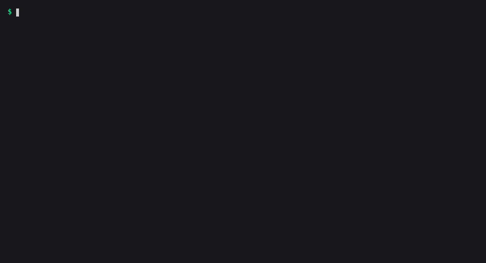

# PHPVERSE — PHP presence & version fingerprint scanner

Détecte si un site tourne sous PHP et tente d'en déterminer la version à partir de plusieurs signaux indépendants (en-têtes HTTP, cookies, `phpinfo()` exposé, easter egg `expose_php`, pages d'erreur, empreintes de CMS), puis confronte la branche trouvée au cycle de support de PHP et à une petite base de failles connues. Teste aussi si un php-fpm (FastCGI) est exposé et cherche des fichiers sensibles oubliés (`.env`, `.git`, sauvegardes de `wp-config`...).
*Detects PHP and estimates its version from headers, cookies, exposed phpinfo(), the expose_php easter egg, error pages and CMS fingerprints, then checks it against PHP's support lifecycle and known issues.*

Compagnon de [Webverse](https://forgejo.london.li/London088/Webverse).

> **Usage autorisé uniquement.** Ne scanner que des hôtes que vous possédez ou pour lesquels vous avez une autorisation écrite. Les résultats sont des heuristiques : à vérifier manuellement avant d'agir.


*Démo sur ma propre machine : un serveur PHP et un php-fpm locaux jetables, avec un `phpinfo()` volontairement exposé. La version du noyau est masquée (« … »).*

## Ce qu'il cherche
| Signal | Exemple |
|---|---|
| En-têtes | `X-Powered-By: PHP/8.3.6`, `Server` (mod_php, phusion) |
| Pile de distribution | `Server: nginx/1.24.0 (Ubuntu)` → PHP 8.3 probable (confiance faible) |
| Cookies | `PHPSESSID`, absence des drapeaux `HttpOnly` / `Secure` |
| Fuites d'erreurs | `display_errors` actif, chemins du serveur dans la page |
| `phpinfo()` | page exposée, version lue directement |
| `expose_php` | logo PHP servi via la chaîne magique (anciennes versions seulement : je ne l'ai pas vu fonctionner sur PHP 8.3) |
| CMS | WordPress (et version minimale de PHP requise), Drupal, Joomla, Magento, PrestaShop, phpBB, MediaWiki, Laravel, Symfony, phpMyAdmin, Nextcloud |
| Fichiers sensibles | `.env`, `.git/HEAD`, `composer.json/.lock`, sauvegardes `wp-config`, phpMyAdmin, Adminer, PHPUnit `eval-stdin.php`, logs Laravel, profileur Symfony, `server-status`, `php-fpm-status` |
| php-fpm | ports FastCGI 9000 / 9001 joignables |

La version trouvée est comparée au cycle de vie officiel (fin de support) et à une liste de CVE notables (CVE-2012-1823, CVE-2019-11043, CVE-2024-4577...). Les CVE propres à Windows ne sont signalées que si une pile Windows (Win32/Win64, IIS) est détectée. Les paquets de distribution reportent les correctifs sans changer le numéro de version : un CVE signalé peut être un faux positif, l'outil le précise.

## Usage
```
python3 phpverse.py exemple.com
python3 phpverse.py https://exemple.com -p 443,8443
python3 phpverse.py -f cibles.txt --json
```

## Options
| Option | Rôle |
|---|---|
| `targets` | Un ou plusieurs hôtes, IP ou URL |
| `-f`, `--file` | Fichier avec une cible par ligne (`#` pour les commentaires) |
| `-p`, `--ports` | Ports web à essayer, séparés par virgule (défaut `443,80`) |
| `-t`, `--timeout` | Timeout par requête (défaut 5 s) |
| `-w`, `--workers` | Sondes concurrentes par hôte (défaut 8) |
| `--fpm-ports` | Ports testés pour php-fpm / FastCGI (défaut `9000,9001` ; `''` pour ignorer) |
| `--json` | Sortie JSON lisible par machine (sans bannière ni couleurs) |
| `--no-color` | Désactive les couleurs |

Aucune dépendance externe (stdlib Python uniquement).
